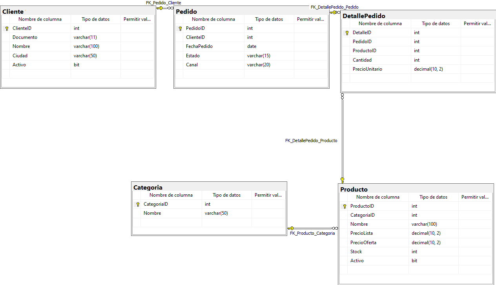
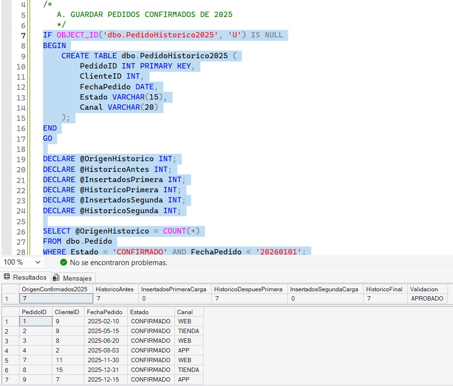
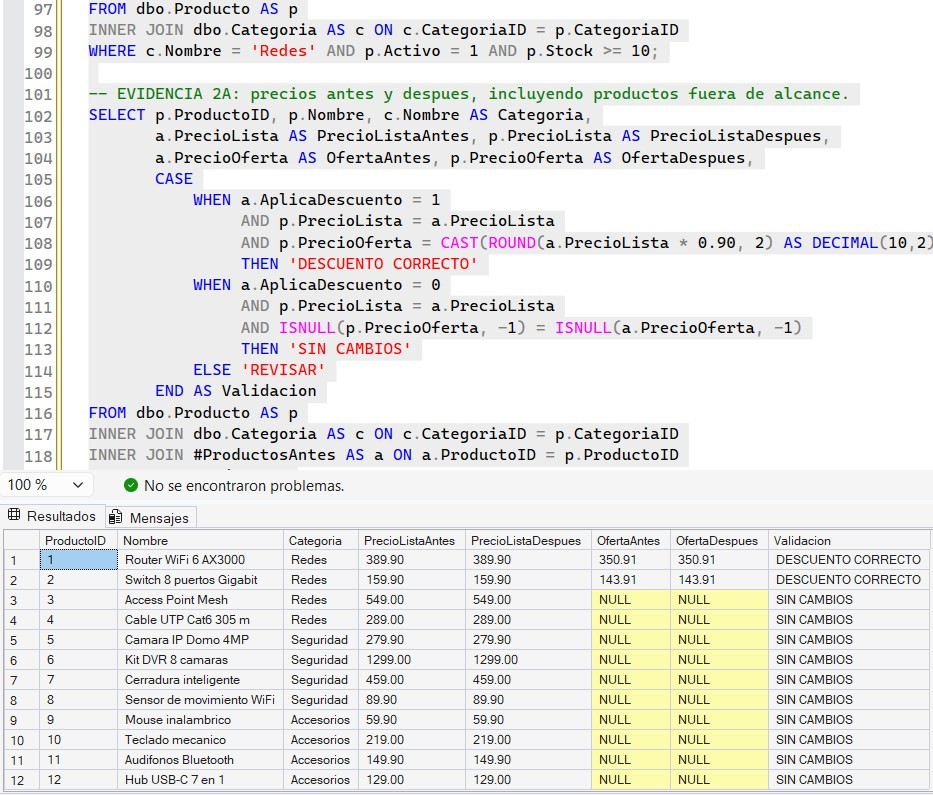
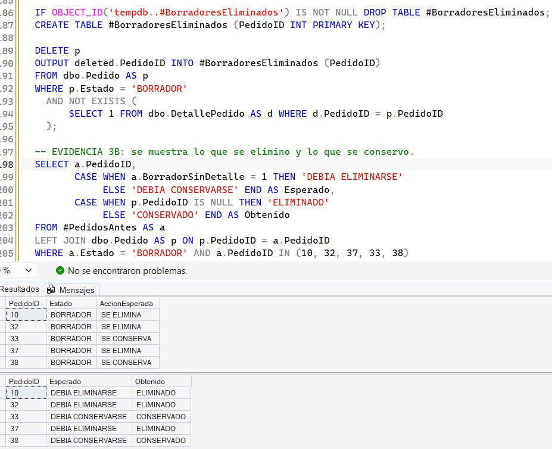
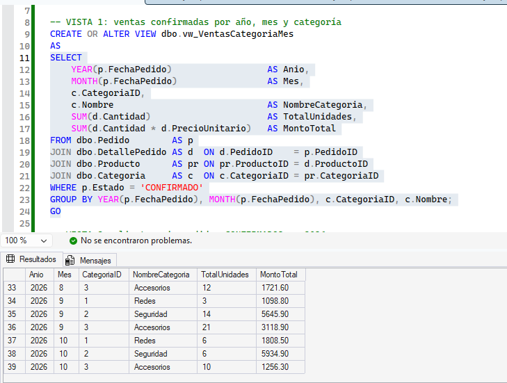
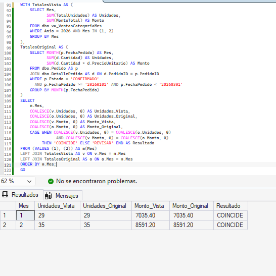
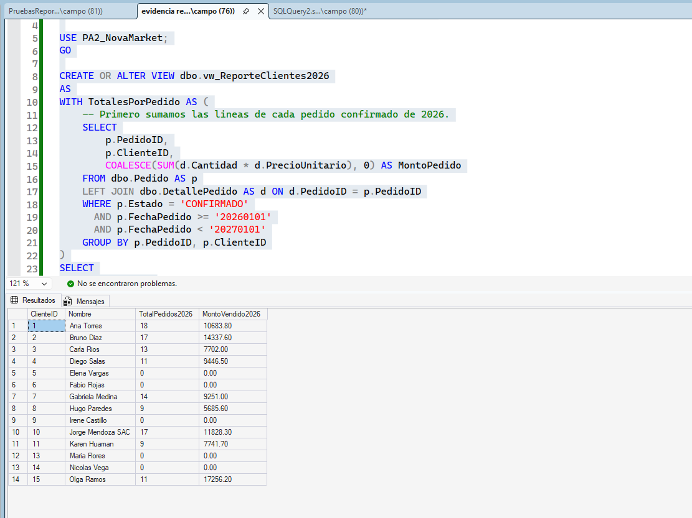
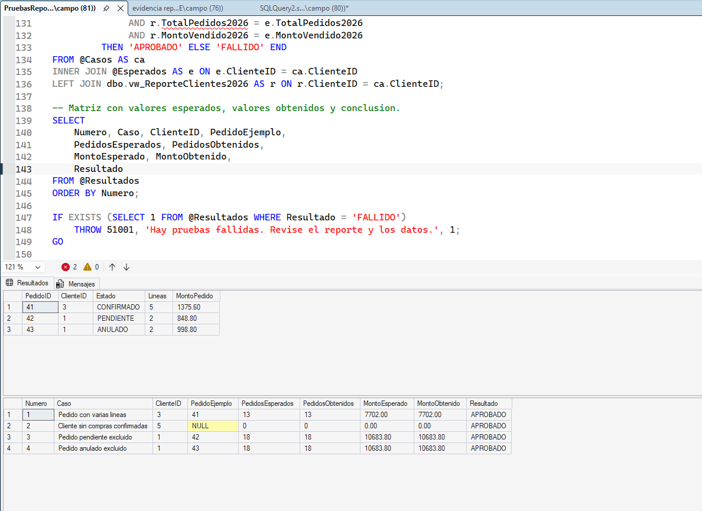

# NovaMarket — PA2 | Programación Avanzada de Base de Datos

**ISIL | Grupo 02**  
**Tecnologías:** Microsoft SQL Server y SQL Server Management Studio (SSMS)

## 1. Presentación del proyecto

NovaMarket es una tienda ficticia de tecnología que comercializa artículos de Redes, Seguridad y Accesorios. En este trabajo usamos una base de datos en SQL Server para resolver consultas comerciales, realizar mantenimiento controlado de registros y comprobar que los reportes reflejen las ventas que realmente fueron confirmadas.

El objetivo es aplicar subconsultas, operaciones de inserción, actualización y eliminación, vistas y pruebas sobre un conjunto de datos suficientemente amplio. Además del resultado de cada consulta, documentamos cómo se verificó y por qué se eligió esa solución.

Para calcular los importes de venta utilizamos el precio almacenado en `DetallePedido.PrecioUnitario`, pues representa el valor registrado en la operación y no el precio actual del catálogo.

## 2. Integrantes y contribuciones

| Integrante | Usuario de GitHub | Aporte desarrollado |
|---|---|---|
| Andy Alexandre Lescano Espino | [@lescanoandye-sketch](https://github.com/lescanoandye-sketch) | Modelo físico, tablas, carga inicial, diagrama y ampliación de los datos de prueba con escenarios identificados. |
| Lucero Helen Corrales Granda | [@Lucero47](https://github.com/Lucero47) | Segmentación con `EXISTS`/`NOT EXISTS`, subconsulta de promedio de precios, casos de contraste y evidencias. |
| Farid Alessandro Mori Barrientos | [@FaridMori](https://github.com/FaridMori) | Carga histórica, actualización de ofertas y eliminación protegida de borradores; comprobaciones antes y después. |
| Fernando Álvaro Quispe Trigos | [@qtfernando-tech](https://github.com/qtfernando-tech) | Vistas de ventas por categoría y de clientes sin compras, con consultas alternativas y comparación de totales. |
| Jorge Raúl Campoblanco Noriega | [@jorgecampoblanco](https://github.com/jorgecampoblanco) | Reporte de pedidos y montos por cliente, pruebas SQL, matriz de resultados y evidencias. |

## 3. Modelo de la base de datos



El modelo principal utiliza cinco tablas relacionadas:

| Tabla | Contenido |
|---|---|
| `Cliente` | Documento, nombre, ciudad y estado de actividad del cliente. |
| `Categoria` | Categorías Redes, Seguridad y Accesorios. |
| `Producto` | Categoría, precio de lista, precio de oferta, stock y estado. |
| `Pedido` | Cliente, fecha, estado y canal de compra. |
| `DetallePedido` | Productos de cada pedido, cantidad y precio unitario registrado. |

Se aplican claves primarias y foráneas, además de restricciones `UNIQUE`, `DEFAULT` y `CHECK` para cuidar la consistencia de la información. El proceso de mantenimiento también crea `PedidoHistorico2025`, donde se guardan los pedidos confirmados anteriores a 2026.

## 4. Requisitos y ejecución del proyecto

Se necesita una instancia de **Microsoft SQL Server** compatible con `CREATE OR ALTER VIEW` (SQL Server 2016 SP1 o posterior) y **SQL Server Management Studio**. Los scripts se ejecutan en T-SQL; no se requiere una aplicación externa ni restaurar un archivo `.bak`.

1. Descargar el repositorio y abrir SSMS.
2. Conectarse a una instancia local o de prueba donde se tenga permiso de crear la base `PA2_NovaMarket`.
3. Ejecutar **cada archivo completo**, de uno en uno, siguiendo el orden de esta tabla.
4. Revisar los resultados en la pestaña **Resultados** de SSMS y compararlos con las evidencias adjuntas.

| Orden | Archivo | ¿Qué realiza? |
|---|---|---|
| 1 | [`sql/00_esquema_y_datos_base.sql`](sql/00_esquema_y_datos_base.sql) | Crea la base de datos, las cinco tablas y los datos iniciales. |
| 2 | [`sql/01_s04_subconsultas.sql`](sql/01_s04_subconsultas.sql) | Resuelve la segmentación de clientes, la comparación de precios y los casos de prueba. |
| 3 | [`sql/04_s07_datos_prueba.sql`](sql/04_s07_datos_prueba.sql) | Agrega pedidos y detalles para llegar al volumen de prueba requerido. |
| 4 | [`sql/02_s05_mantenimiento.sql`](sql/02_s05_mantenimiento.sql) | Ejecuta la carga histórica, los descuentos y la eliminación de borradores con sus verificaciones. |
| 5 | [`sql/03_s06_vistas.sql`](sql/03_s06_vistas.sql) | Crea las vistas y contrasta sus resultados con las tablas originales. |
| 6 | [`sql/05_S07_reporte_ventas_clientes.sql`](sql/05_S07_reporte_ventas_clientes.sql) | Crea y consulta el reporte de ventas por cliente de 2026. |
| 7 | [`evidencias/PruebasReporteClientes.sql`](evidencias/PruebasReporteClientes.sql) | Compara valores esperados y obtenidos para los cuatro escenarios principales. |

El archivo `00_esquema_y_datos_base.sql` elimina y vuelve a crear las tablas principales; por ese motivo, la ejecución completa está pensada para una base de prueba. Con el orden indicado se obtienen primero 210 pedidos, y el mantenimiento elimina tres borradores sin detalle, quedando 207. Las comprobaciones finales del reporte son de solo lectura.

## 5. Desarrollo de las actividades

### 5.1. Subconsultas: segmentación de clientes y comparación de precios

**Script:** [`01_s04_subconsultas.sql`](sql/01_s04_subconsultas.sql)  
**Evidencia:** [`01_s04_subconsultas.pdf`](evidencias/01_s04_subconsultas.pdf)

Se buscan los clientes con al menos un pedido **CONFIRMADO** de productos de **Redes** durante 2026, siempre que no tengan un pedido **CONFIRMADO** de **Seguridad** en ese mismo año. Se eligieron `EXISTS` y `NOT EXISTS` porque permiten comprobar la presencia o ausencia de registros relacionados sin repetir a los clientes por cada producto comprado.

Con los datos preparados, la consulta debe devolver a los clientes **1, 3, 7, 8 y 12**. Los clientes **2 y 10** quedan fuera porque compraron ambas categorías. También se comprueba que un pedido de Seguridad en estado `PENDIENTE` no excluya a un cliente.

La segunda consulta selecciona los productos cuyo `PrecioLista` supera **estrictamente** el promedio de su categoría. Se usa `AVG(PrecioLista)` para todos los productos de esa categoría, activos e inactivos, sin considerar `PrecioOferta`. El promedio se compara sin redondearlo y se redondea únicamente al mostrarlo.

El script también compara `NOT IN` con `NOT EXISTS` cuando aparece un valor `NULL`: con `NOT IN`, una subconsulta que contenga `NULL` puede impedir que se obtengan las filas esperadas. Por eso, para esta segmentación se utiliza `NOT EXISTS`.

### 5.2. Mantenimiento controlado de datos

**Script:** [`02_s05_mantenimiento.sql`](sql/02_s05_mantenimiento.sql)

Se realizaron tres operaciones, cada una con consultas de verificación antes y después:

| Operación | Condición | Resultado esperado |
|---|---|---|
| `INSERT ... SELECT` | Copiar a `PedidoHistorico2025` los pedidos `CONFIRMADO` anteriores al 01/01/2026. | **7 registros** históricos; al repetir la carga no se duplican. |
| `UPDATE` | Aplicar `PrecioOferta = ROUND(PrecioLista * 0.90, 2)` únicamente a productos **activos de Redes** con stock mayor o igual a 10. | Productos **1 y 2** con ofertas de **350.91** y **143.91**; los demás no cambian. |
| `DELETE` | Borrar exclusivamente pedidos `BORRADOR` que no tengan detalles. | Se eliminan los pedidos **10, 32 y 37**, pero se conservan **33 y 38**, que sí tienen detalles. |

El descuento se calcula siempre sobre `PrecioLista`, no sobre la oferta anterior, de modo que repetir la actualización no acumula descuentos. Las verificaciones comprueban también que `PrecioLista` no cambie, que los productos ajenos al filtro permanezcan iguales y que los detalles y pedidos válidos se conserven.

**Carga de pedidos históricos de 2025**



**Aplicación del descuento de productos**



**Control de borradores eliminados y conservados**



Los resultados de [validación del descuento](evidencias/Capturas_evidencias_s05/s05_validacion_decsuento.jpg) y [validación final](evidencias/Capturas_evidencias_s05/s05_validacion_final.jpg) complementan las tres capturas anteriores.

### 5.3. Vistas de ventas y clientes sin compras

**Script:** [`03_s06_vistas.sql`](sql/03_s06_vistas.sql)

Se crearon las siguientes vistas:

- **`vw_VentasCategoriaMes`**: muestra año, mes, categoría, unidades y monto vendido. Solo considera pedidos `CONFIRMADO` y calcula cada importe mediante `Cantidad * PrecioUnitario`.
- **`vw_ClientesSinCompra2026`**: lista clientes sin pedidos confirmados durante 2026, aunque hayan tenido pedidos de otros estados o de otros años.

Para comprobar la primera vista se contrastan los totales de **enero y febrero de 2026** con las líneas de detalle originales; el resultado esperado del contraste es **`COINCIDE`** en los dos meses. La segunda vista se compara con una consulta alternativa mediante `LEFT JOIN` y se revisan las diferencias en ambos sentidos.

El uso de vistas ayuda a reutilizar los criterios de venta confirmada y ausencia de compra sin reconstruir las mismas consultas en cada reporte.

**Ventas confirmadas agrupadas por categoría y mes**



**Comparación de los resultados de enero y febrero**



También se incluye el [resultado de la vista de clientes sin compras](evidencias/s06_Vista2.PNG).

### 5.4. Datos de prueba y reporte de ventas por cliente

**Scripts:** [`04_s07_datos_prueba.sql`](sql/04_s07_datos_prueba.sql) · [`05_S07_reporte_ventas_clientes.sql`](sql/05_S07_reporte_ventas_clientes.sql)  
**Pruebas:** [`PruebasReporteClientes.sql`](evidencias/PruebasReporteClientes.sql)

La carga inicial contiene **15 clientes, 3 categorías, 12 productos, 40 pedidos y 80 detalles**. El conjunto ampliado alcanza **210 pedidos y 433 detalles**. Tras el mantenimiento quedan **207 pedidos y 433 detalles**, por encima del mínimo requerido de 200 y 400.

El reporte muestra **todos los clientes activos**, con estas columnas:

```text
ClienteID | Nombre | TotalPedidos2026 | MontoVendido2026
```

Solo se cuentan pedidos `CONFIRMADO` cuya fecha se encuentre entre el **01/01/2026** y el **31/12/2026**. Para evitar duplicar pedidos con varias líneas de detalle, primero se calcula el monto de cada pedido y después se agrupa por cliente. La unión `LEFT JOIN` mantiene a los clientes sin compras confirmadas, y `COALESCE` muestra montos de **0.00** en lugar de `NULL`.

Se documentaron los escenarios con sus registros de referencia:

| Caso | Referencia | Esperado con los datos del proyecto |
|---|---|---|
| Pedido con varias líneas | Pedido **41**, cliente **3** | Sus cinco líneas se suman, pero el pedido cuenta una vez; el cliente registra **13 pedidos** y **7,702.00**. |
| Cliente activo sin compras confirmadas | Cliente **5** | **0 pedidos**, **0.00**. |
| Pedido pendiente | Pedido **42**, cliente **1** | No se cuenta ni se suma; el cliente conserva **18 pedidos** y **10,683.80**. |
| Pedido anulado | Pedido **43**, cliente **1** | Tampoco se cuenta ni se suma al monto del cliente. |

La matriz SQL obtiene los resultados esperados por un cálculo alternativo sobre las tablas originales y los compara con el reporte, mostrando las columnas **esperadas**, **obtenidas** y **`APROBADO`/`FALLIDO`**. También se prepararon casos de límites de fecha y un cliente inactivo.

**Archivos complementarios:** [escenarios de prueba](evidencias/s07_escenarios_prueba.md), [matriz de los cuatro casos](evidencias/MatrizPruebasReporteClientes.md) y [casos de la carga inicial](evidencias/casos_datos_base.md).

**Reporte de ventas por cliente de 2026**



**Validación de los cuatro escenarios**



## 6. Comprobación de resultados

Las siguientes consultas permiten comprobar el volumen final, la distribución de pedidos y la información que devuelven las vistas y el reporte:

```sql
USE PA2_NovaMarket;
GO

-- Volumen final esperado: 15 clientes, 12 productos,
-- 207 pedidos, 433 detalles y 7 pedidos históricos.
SELECT 'Cliente' AS Tabla, COUNT(*) AS Cantidad FROM dbo.Cliente
UNION ALL SELECT 'Producto', COUNT(*) FROM dbo.Producto
UNION ALL SELECT 'Pedido', COUNT(*) FROM dbo.Pedido
UNION ALL SELECT 'DetallePedido', COUNT(*) FROM dbo.DetallePedido
UNION ALL SELECT 'PedidoHistorico2025', COUNT(*) FROM dbo.PedidoHistorico2025;

-- Distribución por año y estado.
SELECT YEAR(FechaPedido) AS Anio, Estado, COUNT(*) AS Cantidad
FROM dbo.Pedido
GROUP BY YEAR(FechaPedido), Estado
ORDER BY Anio, Estado;

-- Ventas confirmadas por categoría y mes.
SELECT * FROM dbo.vw_VentasCategoriaMes
WHERE Anio = 2026
ORDER BY Mes, MontoTotal DESC;

-- Clientes sin compras confirmadas en 2026.
SELECT * FROM dbo.vw_ClientesSinCompra2026
ORDER BY ClienteID;

-- Reporte final de todos los clientes activos.
SELECT ClienteID, Nombre, TotalPedidos2026, MontoVendido2026
FROM dbo.vw_ReporteClientes2026
ORDER BY ClienteID;
```

La comparación de los cuatro escenarios se encuentra en [`evidencias/PruebasReporteClientes.sql`](evidencias/PruebasReporteClientes.sql). El resultado esperado en cada caso es `APROBADO`. El script de ampliación de datos incluye controles de integridad cuyo resultado esperado es **0 inconsistencias**.

## 7. Consideraciones del proyecto

Los datos son ficticios y los resultados esperados corresponden al conjunto incluido en este repositorio. Si se modifican pedidos, precios, estados o detalles, algunas cifras de referencia tendrán que actualizarse.

El script inicial vuelve a crear las tablas principales. La carga ampliada reconoce cuándo ya existen pedidos del rango previsto, pero no repara automáticamente una inserción interrumpida. Por eso, las operaciones de mantenimiento y las pruebas se trabajan sobre una base de práctica.

Las capturas complementan los archivos SQL; no reemplazan la ejecución y revisión de las consultas en SQL Server.

## 8. Conclusiones

El caso permitió comprobar que obtener un resultado no es suficiente: también hay que verificar qué registros intervienen en los cálculos y cuáles deben quedar fuera. Las subconsultas ayudaron a identificar clientes según sus compras, las operaciones DML permitieron realizar cambios delimitados y las vistas simplificaron la reutilización de reportes.

En el reporte final fue especialmente importante contar cada pedido una sola vez, mantener a los clientes sin compras válidas y usar los precios históricos del detalle. Las consultas de contraste y la matriz de pruebas sirven para detectar resultados incorrectos antes de presentarlos como información comercial.

## 9. Video de sustentación

**Enlace de YouTube: https://youtu.be/xwFX3iYvLZ8?si=N8JD-i1mM5OFTpGS **

